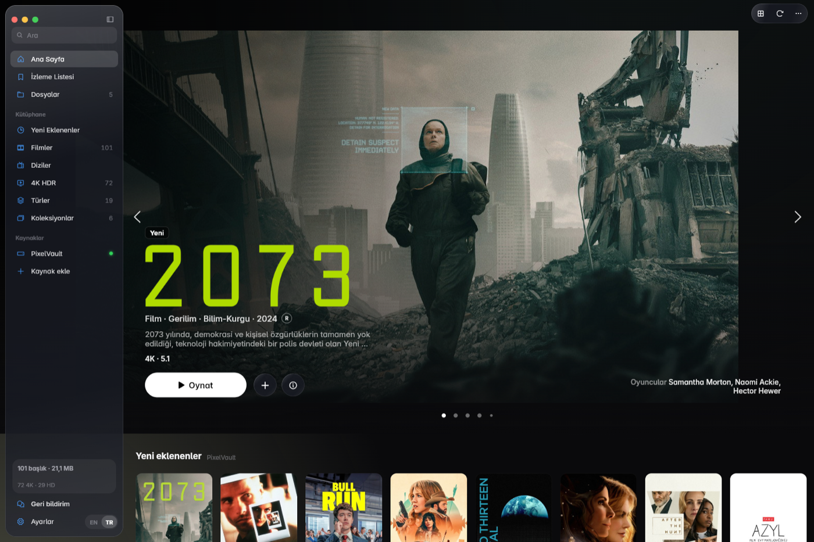
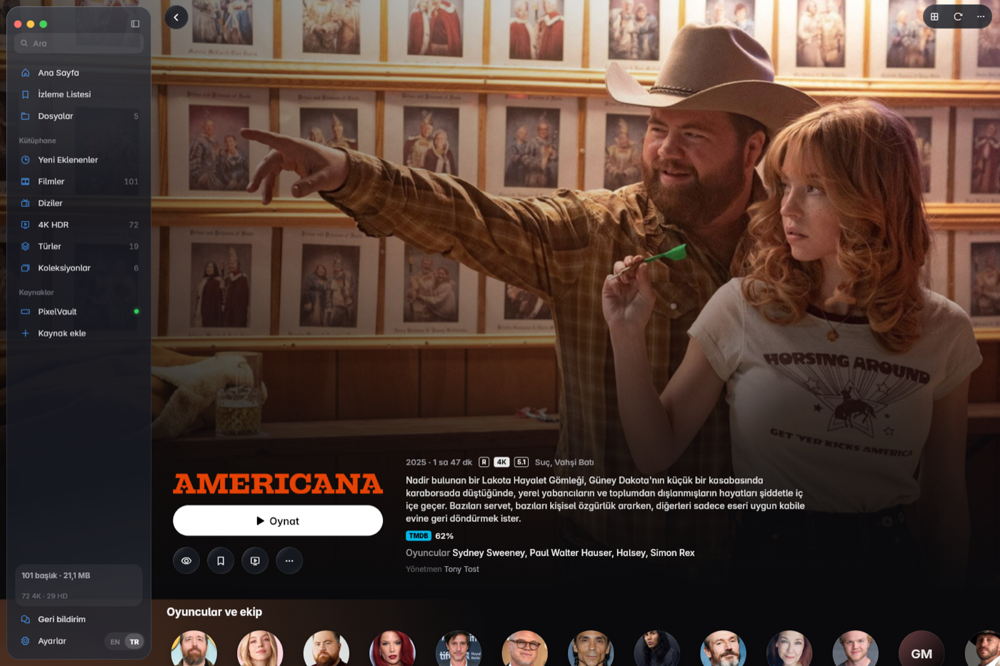
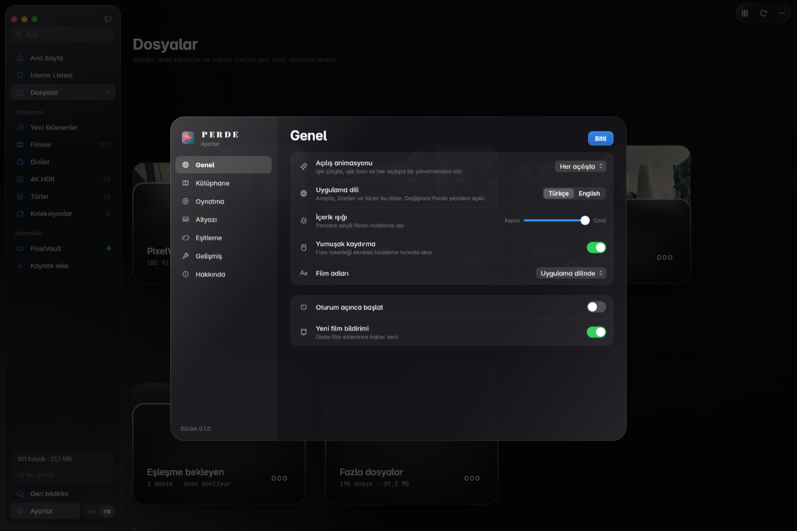

<div align="center">



<br>


*A free app that turns a folder of films into an Apple TV style library.*<br>
*Posters, summaries, ratings and Turkish subtitles arrive by themselves; nothing is locked, no account, no tracking.*

**[perde.kutluhangil.dev](https://perde.kutluhangil.dev)** · take the live tour, in English and Turkish

<br>



<sub>This repository holds the installers and release notes. The source code is private.</sub>

</div>


## Download

Get the latest version from **[Releases](https://github.com/kutluhangil/Perde-Releases/releases/latest)**.

| System | File | Notes |
|---|---|---|
| **macOS 26 or newer**, Apple Silicon | [`Perde-macOS-arm64.dmg`](https://github.com/kutluhangil/Perde-Releases/releases/latest/download/Perde-macOS-arm64.dmg) | Open the DMG, drag Perde to Applications |
| **Linux x86_64**, any distro (glibc 2.39+, e.g. Ubuntu 24.04+) | [`Perde-Linux-x86_64.AppImage`](https://github.com/kutluhangil/Perde-Releases/releases/latest/download/Perde-Linux-x86_64.AppImage) | One file, libmpv inside |
| **Linux arm64** | [`Perde-Linux-aarch64.AppImage`](https://github.com/kutluhangil/Perde-Releases/releases/latest/download/Perde-Linux-aarch64.AppImage) | Same, for ARM machines |
| **Ubuntu / Debian x86_64** | [`perde_amd64.deb`](https://github.com/kutluhangil/Perde-Releases/releases/latest/download/perde_amd64.deb) | Uses the system's `libmpv2` |
| **Ubuntu / Debian arm64** | [`perde_arm64.deb`](https://github.com/kutluhangil/Perde-Releases/releases/latest/download/perde_arm64.deb) | Same, for ARM machines |
| **Windows 11** | coming soon | ARM64 first, then x64 |

## Install

**macOS.** Perde is not signed with an Apple Developer ID yet, so macOS stops the first launch with
"Apple could not verify Perde". Open **System Settings › Privacy & Security**, scroll down and click **Open Anyway**
next to Perde (once). Or in Terminal:

```sh
xattr -dr com.apple.quarantine /Applications/Perde.app
```

**Linux, AppImage.**

```sh
chmod +x Perde-Linux-x86_64.AppImage
./Perde-Linux-x86_64.AppImage
```

**Linux, .deb.**

```sh
sudo apt install ./perde_amd64.deb   # pulls in libmpv2, GTK 3 and libsecret
```

## Updates

Perde looks at this repository a few seconds after it starts and shows a short note when a new version is out.
**Settings › About › Check for updates** checks on demand and opens the right file for your system (DMG on a Mac,
AppImage when you run the AppImage, .deb when you installed the .deb). Install it over the old one; your library,
progress and settings stay. The App Store version, when it comes, will update through the App Store instead.


## A cinema for the folder you already have

Most people keep films on a disk: folders with release names, a `.mkv` inside, maybe a subtitle, usually a banner
and some leftover files nobody asked for. Perde points at that folder once and gives it back as a cinema: a hero
with the film's logo, rows of posters, the film's own colours in the window light, and a player that opens anything.

It reads the file name (title, year, quality, codec, audio, season and episode), finds the film or show on TMDB,
fetches its artwork, scores from IMDb, Rotten Tomatoes and Metacritic, and the subtitle in your language, matched
to the exact file by its hash.

> Perde never invents a poster, a score or a subtitle. When something is not known it says so, and nothing it does
> to your disk skips the Trash without asking.

| | | |
|:---:|:---:|:---:|
|  |  |  |
| <code>Home</code><br><sub>hero, rows, continue watching</sub> | <code>Film page</code><br><sub>summary, scores, cast</sub> | <code>Settings</code><br><sub>library, player, subtitles, about</sub> |

## Features

| | |
|---|---|
| **Apple TV style home** | Rotating hero with title logo, Continue Watching with progress, Recently Added |
| **Library** | Movies, TV Shows, 4K HDR, Genres, Collections, Watchlist, and a view per disk |
| **TV shows** | `S01E02` / `1x02` episodes gather under one show, with seasons and Up Next |
| **Film page** | Wide Play, TMDB / IMDb / Rotten Tomatoes / Metacritic, cast, where it streams, the file's specs |
| **Player** | MKV, MP4, AVI and more, Blu-ray / DVD folders, chapters, frame step, go to time (`G`), screenshots |
| **Subtitles** | OpenSubtitles by file hash with SubDL as fallback, your language first, two subtitles at once |
| **Files** | Glass folders per disk plus smart ones: 4K, without subtitles, waiting for a match, leftovers |
| **Library cleanup** | Release tags out of folder names, leftover files to the Trash; progress and matches kept |
| **Two languages** | English and Turkish, switchable from the sidebar |
| **Feedback** | "Feedback" above Settings opens a short form that your mail app sends to the developer |
| **macOS only** | Liquid Glass, picture-in-picture, AirPlay, smart upscaling, Dolby Vision, iCloud sync between Macs |

## Privacy

- No account, no analytics, no tracking. Your films stay on your disk; Perde only reads them.
- To find posters and subtitles, Perde sends the film's title, year or the file's hash to TMDB, OMDb,
  OpenSubtitles and SubDL through Perde's own key server (`perde-keys.kutluhangil.dev`), which adds the API keys
  and passes the answer back. No keys ship inside the app, and the server keeps no logs of what you watch.
- Feedback goes from your own mail app, so the reply comes back to your address.


## Türkçe özet

Perde, diskindeki film klasörünü Apple TV benzeri bir kütüphaneye çeviren ücretsiz bir uygulama. Canlı tur ve ayrıntılar: [perde.kutluhangil.dev](https://perde.kutluhangil.dev/tr/). Afişler, özetler,
puanlar ve Türkçe altyazılar kendiliğinden gelir; hesap, abonelik ya da takip yok. Kurulum dosyaları yukarıdaki
**Download** tablosunda ve [Releases](https://github.com/kutluhangil/Perde-Releases/releases/latest) sayfasında:
Mac için DMG, Linux için AppImage ve .deb, Windows yakında. Yeni sürüm çıkınca uygulama haber verir;
**Ayarlar › Hakkında › Güncellemeleri denetle** ile sisteme uygun dosyayı açar. Mac'te ilk açılışta "Apple doğrulayamadı"
uyarısı çıkarsa **Sistem Ayarları › Gizlilik ve Güvenlik › Yine de Aç**'a bas.

## Feedback

Use **Feedback** in the app's sidebar, or open an [issue](https://github.com/kutluhangil/Perde-Releases/issues).

<a href="https://github.com/kutluhangil"></a>

<sub>Free to use; all rights reserved. This product uses the TMDB API but is not endorsed or certified by TMDB. Screenshots show the Linux version with film data from TMDB.</sub>
